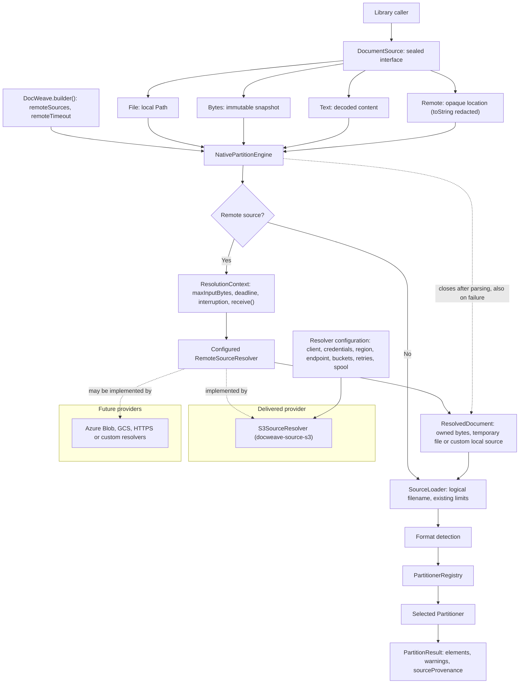
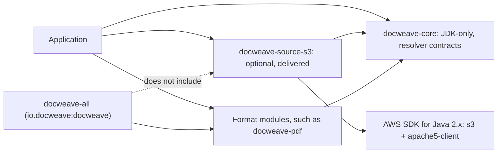
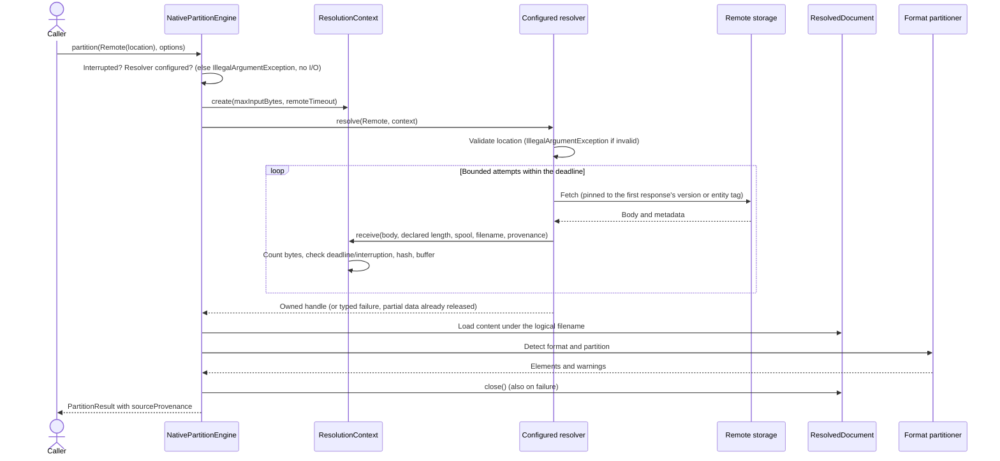

# Remote document sources — design

Status: implemented on `dev` for 0.1.0-beta.9 (#13). The core contracts and the optional `docweave-source-s3`
module are delivered; Azure Blob, Google Cloud Storage and HTTPS providers are future work (see
[Delivered and future](#delivered-and-future)). Nothing here is published to Maven Central yet. The existing
`File`, `Bytes` and `Text` sources work exactly as before without a resolver or network dependency, and core remains
JDK-only and Java 21 compatible. The [tutorial](remote-sources-tutorial.md) shows configuration step by step.

## Purpose and user-facing API

Callers partition a document held in remote storage without implementing downloading, size enforcement, deadlines,
cancellation or temporary-file cleanup themselves. Acquisition is optional and separate from parsing.

```java
try (var resolver = S3SourceResolver.builder()          // docweave-source-s3, explicitly configured
        .region("eu-west-1")
        .credentials(DefaultCredentialsProvider.builder().build())
        .defaultBucket("reports")
        .build()) {
    var processor = DocWeave.builder().remoteSources(resolver).build();
    var result = processor.partition(DocumentSource.remote("2026/annual-report.pdf"), options);
    var provenance = result.sourceProvenance();          // s3://reports/2026/annual-report.pdf, version, bytes, sha256
}
```

The location is an opaque string, not necessarily a URI. Core passes it unchanged to the processor's resolver; it does
not parse a scheme, bucket, key, path or provider name. Each resolver documents its own syntax and throws
`IllegalArgumentException` for an invalid or unsupported location. `DocumentSource.remote` rejects only null and
performs no I/O. `Remote.toString()` redacts the location because object names can be sensitive.

A processor has at most one resolver, configured explicitly. An application with several providers supplies a
composite resolver with its own explicit routing. Core never probes providers, selects one implicitly or downloads
twice.

## Component architecture



| Component | Owns | Does not own |
|---|---|---|
| `DocumentSource.Remote` | Opaque location value | Network access, credentials or provider selection |
| `DocWeave.builder()` | Explicit resolver registration and the finite acquisition timeout | Implicit discovery; it does not close the resolver |
| `NativePartitionEngine` | Resolution lifecycle, context creation, cleanup, provenance in the result | Provider location syntax |
| `ResolutionContext` | Byte ceiling, deadline, interruption, bounded `receive` into memory or temporary files, SHA-256 | Provider protocols |
| `RemoteSourceResolver` | Location validation, acquisition, retries, provider error mapping | Parsing |
| `ResolvedDocument` | Content handle, logical filename, safe provenance, exactly-once cleanup | Credentials or parser state |
| `SourceLoader` | Existing loading, limits and decoding, under the logical filename | Remote protocols |
| Format partitioners | Parsing through `PartitionContext` | Storage clients or temporary-file deletion |

## Module dependencies



The `Remote` variant lives in core with the sealed interface. Providers implement the open `RemoteSourceResolver`
interface instead of adding `DocumentSource` subtypes. No SDK is added to core, and `docweave-source-s3` is not part of
`docweave-all`. No ServiceLoader discovery is used for resolvers: installing the module creates no client, reads no
credentials and makes no network call.

## Contracts (as implemented)

All in package `io.docweave.partition` (core):

```java
record Remote(String location) implements DocumentSource {}              // DocumentSource.remote(location)

@FunctionalInterface
public interface RemoteSourceResolver {
    ResolvedDocument resolve(DocumentSource.Remote source, ResolutionContext context) throws IOException;
}

public interface ResolutionContext {
    int maxBytes();                  // the call's PartitionOptions.maxInputBytes
    Duration remaining();            // until the processor's remote timeout
    void checkActive() throws IOException;              // interruption or deadline
    AutoCloseable abortOnStop(Closeable abort);         // unblocks a stalled transport read
    ResolvedDocument receive(InputStream body, long declaredBytes, SpoolPolicy spool, String filename,
            Function<Received, SourceProvenance> provenance) throws IOException;
    static ResolutionContext create(int maxBytes, Duration timeout);   // testing/standalone use
}

public interface ResolvedDocument extends AutoCloseable {
    DocumentSource localSource();    // File, Bytes or Text; never Remote
    String filename();               // logical name for routing, metadata and element IDs
    SourceProvenance provenance();
    void close() throws IOException; // idempotent
    static ResolvedDocument of(DocumentSource local, String filename, SourceProvenance provenance, Closeable release);
}

public record SourceProvenance(String provider, String reference, String version, String entityTag,
        String filename, long bytes, String sha256) {}

public record SpoolPolicy(Path directory) { static SpoolPolicy memory(); static SpoolPolicy temporaryFile(Path dir); }

public final class RemoteSourceException extends IOException {   // reason(): NOT_FOUND, ACCESS_DENIED,
}                                                                  // DEADLINE_EXCEEDED, INCOMPLETE, UNAVAILABLE,
                                                                   // INVALID_RESPONSE
```

`DocWeave.builder()` returns `DocWeave.Builder` with `registry`, `remoteSources`, `remoteTimeout` (default 2 minutes,
at most one day) and `build`. `DocWeave.create()` and `create(registry)` remain local-only.
`PartitionResult` gained a seventh component, `sourceProvenance` (null for local inputs); the six-argument constructor
is retained.

### Limits, deadline and cancellation

- **Byte ceiling.** `ResolutionContext.maxBytes()` is the call's `maxInputBytes`. `receive` counts bytes actually
  received, refuses a declared length above the ceiling before reading, and fails with
  `PartitionException.Code.INPUT_TOO_LARGE` (the same category as local inputs) as soon as one byte too many arrives,
  also when Content-Length is missing. It never truncates. The loader's existing limit applies again after resolution.
- **Exact length.** A body shorter or longer than its declared length fails with `INCOMPLETE`.
- **Deadline.** The processor's `remoteTimeout` bounds acquisition, measured from the start of the call. Loading and
  parsing afterwards keep their existing limits and interruption checkpoints; the existing partition options have no
  overall parsing deadline, and this feature does not invent one. Callers wanting an end-to-end deadline use
  interruption (for example `BatchOptions` deadlines).
- **Cancellation.** Interrupting the calling thread cancels acquisition with `InterruptedIOException` and preserves the
  interrupt status. `abortOnStop` (used by `receive`, and by the S3 resolver for the HTTP response) runs an abort action
  from one shared, lazily created daemon thread when the deadline passes or the caller is interrupted, so a socket read
  that ignores interruption is released promptly.

### Ownership and cleanup

`receive` releases partial content (memory or temporary file) before throwing. Once a resolver returns a handle, the
engine owns it and closes it with try-with-resources: on success, parser failure, limit failure and cancellation. A
cleanup failure after a successful parse is thrown; after a primary failure it is attached as a suppressed exception.
`ResolvedDocument.close()` runs its release exactly once. Remote-to-Remote resolution is refused.

### Memory and temporary files

Core loading materializes every input in memory (as for `File` and `Bytes`). `SpoolPolicy.memory()` (the default)
therefore writes no file: the download is received into one exact-length array (exact allocation when the length is
declared) and handed to the loader **without further copying**. `SpoolPolicy.temporaryFile(dir)` buffers the download
in an owner-only (`rw-------` on POSIX) randomly named file in an explicit directory, deleted on close or failure; the
loader then reads it under the same ceiling. A temporary file's random name never becomes the logical filename.

## Runtime interaction



| Failure | Behavior |
|---|---|
| Remote source without a resolver | `IllegalArgumentException`; no network access |
| Invalid or unsupported location | Resolver throws `IllegalArgumentException`, before any request |
| Missing object or bucket | `RemoteSourceException` `NOT_FOUND`, not retried |
| Access denied | `RemoteSourceException` `ACCESS_DENIED`, not retried |
| Service or network failure, HTTP 5xx/429, incomplete body | Retried within the attempt limit and deadline; then `UNAVAILABLE` or `INCOMPLETE` |
| Object changed between attempts | `INVALID_RESPONSE` (conditional retry failed) |
| Input exceeds the ceiling | `PartitionException` `INPUT_TOO_LARGE`; partial data released; never truncated or retried |
| Deadline | `RemoteSourceException` `DEADLINE_EXCEEDED`; transport aborted; cleanup |
| Caller interruption | `InterruptedIOException`, interrupt status preserved; transport aborted; cleanup |
| Detection or parser failure | Existing diagnostics; handle closed |
| Cleanup failure | Thrown after success, suppressed onto a primary failure |

## S3 provider (`docweave-source-s3`)

- **Locations.** `s3://bucket/key` with optional `?versionId=ID` (the key is percent-decoded; `%3F`, `%23` and `%25`
  write `?`, `#` and `%`), or a key relative to the configured default bucket, used verbatim (latest version). Bucket
  names are validated; an allow-list can restrict buckets. Locations never select an endpoint or credentials, so a
  location cannot redirect the resolver to another service (no SSRF surface).
- **Configuration.** Either a caller-owned `S3Client` (never closed by the resolver; its own retries and timeouts apply
  within each attempt), or an owned client built from an explicit region and credentials provider, optional
  S3-compatible endpoint and path-style addressing, connect/socket timeouts, and closed by `S3SourceResolver.close()`.
  There is no implicit credential discovery: the AWS default chain is used only if passed explicitly.
- **Retries.** At most `maxAttempts` (default 3), with jittered exponential backoff that never exceeds the remaining
  deadline. The first response pins later attempts to its version ID, or, for unversioned objects, to its entity tag
  through `If-Match`, so a retry never mixes object generations.
- **Concurrency.** `maxConcurrentDownloads` (default 16) bounds transfers per resolver; a call waits for a slot only
  until its deadline.
- **Provenance.** Provider `s3`, reference `s3://bucket/key`, the version actually read (absent for unversioned
  objects, which are mutable and not reproducible snapshots), the unquoted entity tag (opaque, not necessarily a content
  hash), logical filename (last key segment), received bytes and the SHA-256 computed while receiving.
- **Secrets.** Failure messages carry the HTTP status and S3 error code only; SDK messages, endpoints, credentials and
  temporary paths are not included.

## Provenance and element identity

`PartitionResult.sourceProvenance()` reports the provenance; element metadata and element IDs are unchanged. IDs depend
on the logical filename, text and position, so the same bytes and filename give identical elements and IDs locally and
remotely (tested for TXT, HTML, DOCX and PDF, for both spool policies, with fake resolvers and real S3-compatible
services).

## Concurrency and compatibility

Resolvers are thread-safe; each call gets its own context, handle and cancellation state. Nothing is cached: partitioning
the same `Remote` value again fetches again, and may observe newer content of a mutable object.

Adding `Remote` to the sealed interface is a **source-compatibility change** for consumer code with exhaustive
`switch` statements over `DocumentSource`: such code must add a `Remote` case or a default branch. In this repository,
`DefaultPdfPageCropRenderer` now rejects `Remote` with `IllegalArgumentException` (page crops need local bytes).
`PartitionResult` record patterns with six components must add the seventh. Local calls start no thread, network
activity or credential lookup and produce unchanged output.

## Studio integration seam

Studio stores uploads durably in S3-compatible artifact storage before processing. The intended integration keeps
Studio's responsibilities and changes only how processing obtains bytes:

- Studio keeps artifact IDs, authorization, integrity verification and retention. Its processing code receives only a
  `DocumentSource`.
- A Studio-owned `RemoteSourceResolver` maps a Studio-internal artifact reference (for example `artifact:<uuid>` in the
  owning workspace) to its storage object. It can wrap `S3SourceResolver` configured with Studio's existing storage
  client and credentials, so credentials never enter task payloads or locations, or read through Studio's artifact
  service directly.
- One acquisition per stage, received in memory: this removes the scratch-file copy, avoids a second download and
  satisfies Studio's goal of not writing processing inputs to the local filesystem (docweave-studio#143).
- Studio can verify its stored checksum against `SourceProvenance.sha256()`.

The Studio migration is separate work, tracked in docweave-studio#144; this ticket delivers the library capability.

## Validation

- Core: `ResolutionContextTest` (10 tests) and `RemoteSourceContractTest` (11) with fake resolvers: unchanged opaque
  locations, missing resolver, invalid locations, cleanup on every path, byte ceilings, deadlines, cancellation, 64
  concurrent calls, local/remote parity.
- S3 module: `S3LocationTest` (3), `S3SourceResolverFaultTest` (11) against a scripted local endpoint (5xx, 429-style
  throttling, truncated and oversized bodies, stalls, pinning, concurrency limits, client ownership), and
  `S3CompatibleServiceIntegrationTest` (6 scenarios per service).
- **S3-compatible qualification, not AWS qualification.** The service tests run against S3Mock 5.2.3 in the build
  (it implements the S3 REST API, including versioning, but does not enforce authentication) and, through
  `benchmarks/review/remote-sources/seaweedfs-qualification.sh`, against SeaweedFS 4.48 with enforced per-identity
  access, which qualifies access denial. **No test ran against AWS S3.** AWS-specific behavior (SigV4 against real IAM
  policies, KMS-encrypted objects, requester-pays buckets, S3 Express directory buckets, real throttling and
  regional redirects) is not established by these tests.

## Delivered and future

| Item | Status |
|---|---|
| `DocumentSource.Remote`, resolver contracts, context, spooling, engine integration, provenance | Delivered |
| `docweave-source-s3` (AWS S3 and S3-compatible endpoints) | Delivered |
| AWS S3 qualification with real credentials | Not done |
| Azure Blob, Google Cloud Storage, HTTPS providers | Future; the generic contract supports them |
| Typed version/request objects beyond the S3 location syntax | Future, if needed |
| Ranged or streaming parsing of very large objects | Not planned: core materializes inputs |
